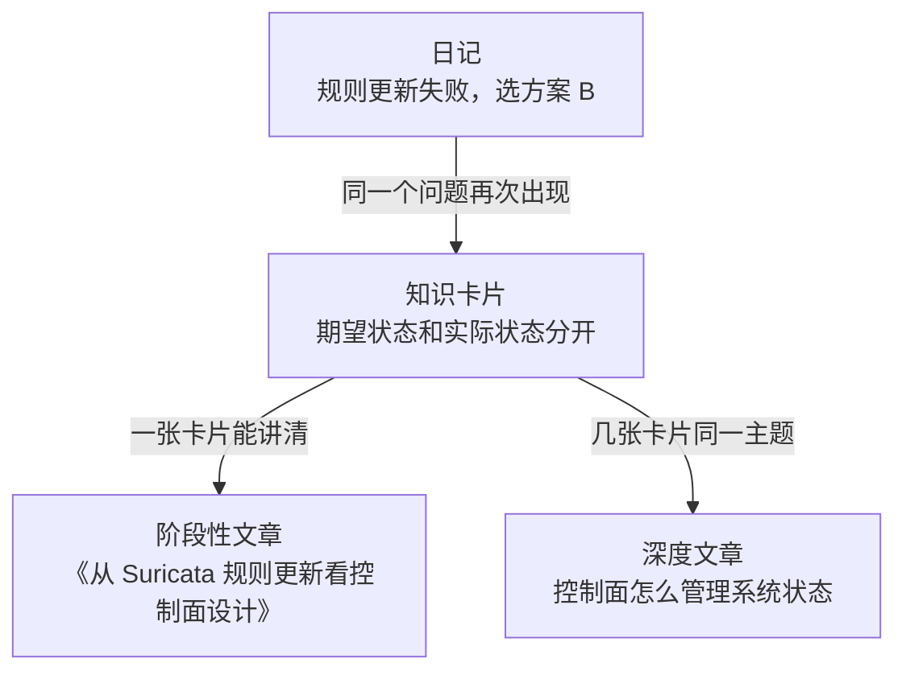

# 程序员如何践行 Learn in Public：建立自己的技术成长系统

## 1. 为什么程序员需要 Learn in Public？

过去程序员的成长路径通常是：

```
学习技术 -> 写代码 -> 解决问题 -> 积累经验
```

AI Coding 把写代码和重复开发的成本降下来了。

代码便宜之后，程序员自己要做的是判断：

- 这段系统为什么这样设计；
- 问题的根因在哪里；
- 这个方案凭什么成立。

这些判断发生在项目里，项目结束就散了。

> 写了很多代码，解决了很多问题，几年后回头看，经验还留在当时的项目里，认知没有留下。

Learn in Public 的价值，就是把解决问题过程中的思考和判断记下来，让一次性的工作经验变成长期技术资产。

# 2. Learn in Public 不只是写技术文章

很多人第一次接触 Learn in Public，会认为：

> Learn in Public 就是持续写博客。

实际上，写博客只是最终表现形式。

它真正关注的是：

> 公开记录自己的学习过程、问题分析过程和认知变化过程。

例如：

```
今天学习了 Redis。
```

只记下了主题。更好的记录是理解怎么变了：

```
之前：缓存只是为了提升访问速度。

现在：缓存在系统里多了一层数据状态，
要处理一致性、失效和故障恢复。
```

后者记录的是思考过程。这才是 Learn in Public 的核心。

# 3. 建立学习日志系统

想长期实践 Learn in Public，先有一个简单的学习日志。素材来自工作里的问题。

三层，按问题是不是反复出现往上走：



## 第一层：Daily Notes日记

每天几分钟。先把问题和当时的选择存下来，不必当天找到答案。问题本身就是以后学习的入口。

```
问题：

Suricata 规则更新失败后，如何保证服务还能用？

当前流程：

用户提交规则 → 覆盖规则文件 → reload Suricata

风险：

新规则语法错误时，reload 失败，旧规则可能丢失。

方案 A：直接覆盖。无法恢复。

方案 B：v1 还在，v2 失败就回滚到 v1。

选择：方案 B。

还没解决：reload 失败怎么检测？
```

## 第二层：Knowledge Notes知识卡片

同一个问题反复出现，再从日记里抽出来。

日记里反复出现的是「Suricata 规则更新失败」。写成卡片：

```
# 配置变更系统设计

问题：如何安全修改线上配置？

常见方案：

方案 A：原地修改。不可恢复。
方案 B：当前是 v1，候选是 v2，失败就回滚。

我的选择：方案 B。

理解：控制面不能直接改运行状态，要分开期望状态和实际状态。
```

卡片记的是自己的选择，不是把资料抄一遍。

## 第三层：Public Article公开文章

一张卡片写清楚了，可以先公开这一次判断。

卡片里写清楚的是「配置变更系统设计」。写成文章：

```
# 从 Suricata 规则更新看控制面设计

背景：

用户提交规则 → 覆盖规则文件 → reload Suricata。
新规则语法错误时，reload 失败，旧规则可能丢失。

比较：

方案 A：直接覆盖。无法恢复。
方案 B：v1 还在，v2 失败就回滚到 v1。

选择：

方案 B。

还没解决：

reload 失败怎么检测？
```

文章公开的是思考过程。同类卡片多了几张，比如规则热更新、配置版本、reload 检测，再合成更深的一篇，谈控制面怎么管理系统状态。

# 4. Learn in Public 最重要的原则

## 不要记录“我学了什么”

而应该记录：

## “我的理解发生了什么变化”

低价值：

```
今天学习了 TCP。
```

高价值：

```
以前：

TCP只是建立连接的协议。


现在：

理解TCP实际上是在分布式环境中，
帮助双方建立通信状态和一致认知。
```

真正的成长，来自认知模型的变化。

# 5. 一个适合程序员的长期实践方案

推荐：

| 内容       | 什么时候写                                       | 目标           |
| ---------- | ------------------------------------------------ | -------------- |
| 日记       | 每天                                             | 记下这次判断   |
| 知识卡片   | 每3天回看日记，同一个问题再次出现再整理           | 留下自己的选择 |
| 阶段性文章 | 每周一篇，选一张已经能讲清的卡片                 | 公开这次判断   |
| 深度文章   | 几张卡片合成一个主题再写，常常一个月左右         | 建立领域理解   |

最终形成：

```
工作里的判断
    ↓
   日记
    ↓
知识卡片
    ↓
公开文章
    ↓
获得反馈 
    ↓
修正判断
```

# 总结

Learn in Public 并不是要求程序员成为技术博主。

它真正解决的问题是：

> 如何避免自己的技术经验随着时间流失。

优秀程序员的成长过程，不只是不断写代码，而是：

```
解决问题
    ↓
总结规律
    ↓
形成方法
    ↓
建立自己的技术体系
```

在 AI 时代，代码生成能力正在快速普及，而理解问题、判断方案、构建知识体系的能力，会成为程序员长期竞争力的重要来源。

Learn in Public，就是帮助程序员把每天的工作经验，转化为长期技术资产的一种实践方式。